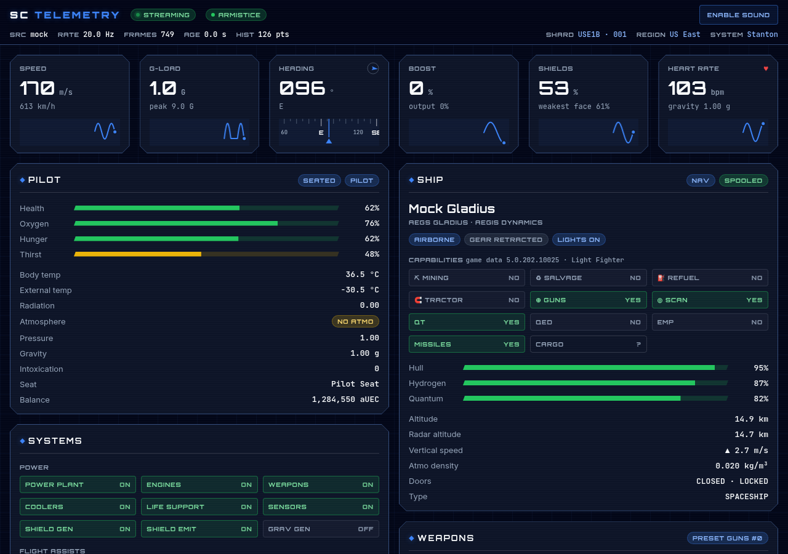

# sc-telemetry

[](https://github.com/voidput/sc-telemetry/actions/workflows/ci.yml)

Unofficial client, documentation and live dashboard for **Star Citizen's local Game Telemetry API**, the gRPC service `sc.game.telemetry.v1.GameTelemetryService` that the game client can host on localhost. It is present in LIVE 4.10 and PTU 5.0, and CIG has not documented it.

> Unofficial fan project, not affiliated with or endorsed by Cloud Imperium Games. Uses only the game's own configuration switches; no game files are modified. Behaviour may change with any patch. See [Legal](#legal-and-disclaimer).



## What you get

- **The schema:** extracted at runtime from your own `StarCitizen.exe` and cached per build in `.tmp/proto/<branch>-<CL>/` (`sctelemetry/schema.py`). No CIG-derived files are committed.
- **Live data at about 20 Hz:**
  - Player vitals: heart rate, health, oxygen, G-load, temperature, radiation.
  - Ship: speed, heading, fuel, boost, hull, shield faces, master mode, power state, annunciators, landing gear, IFCS assists.
  - Weapons and countermeasures, plus game events.
- **Limited write access:** pressing or holding allowlisted input actions through `TriggerGameAction`.
- **A dashboard:** a FastAPI bridge that relays the gRPC stream to a browser over SSE, with recording and replay.

## Docs

- [Install guide](docs/install.md): step-by-step setup for Windows and Linux, troubleshooting, uninstall.
- [API spec](docs/telemetry/api-spec.md): transport, enabling, RPCs, the read/write model, data gotchas, security and versioning.
- [API reference](docs/telemetry/api-reference.md): generated tables of every message, field and enum, with observed ranges.
- [Discovery notes](docs/telemetry/game-telemetry-api.md): how it was found and the test log.

## Quick start

Works on **Windows** and **Linux** (Wine / LUG Helper / Lutris / Steam Proton). The bridge runs on the same PC as the game. Both OSes are tested in CI; Windows has not yet been verified against a live game, so reports are welcome. **Step-by-step guide for players, with troubleshooting: [docs/install.md](docs/install.md).**

1. **Install [uv](https://docs.astral.sh/uv/)** (it fetches Python 3.13 itself): Windows `winget install astral-sh.uv`, Linux `curl -LsSf https://astral.sh/uv/install.sh | sh`. Then `git clone https://github.com/voidput/sc-telemetry.git` (or download the [ZIP](https://github.com/voidput/sc-telemetry/archive/refs/heads/main.zip)) and open a terminal in the folder.
2. **Set two environment variables for the game.** Windows: `setx GRPC_CLIENT_SERVER_ENABLED 1` and `setx GRPC_CLIENT_SERVER_PORT 50051`, then fully quit the RSI Launcher (tray icon too) and start it again; the game inherits them from the launcher. Linux: `export` both in the script or Lutris / Steam settings that start the launcher under Wine.
3. **Add to `USER.cfg`** in your channel folder, e.g. `C:\Program Files\Roberts Space Industries\StarCitizen\PTU\USER.cfg` (create it if missing):

   ```ini
   server.game.telemetry.enabled = 1
   ; optional: let local programs press allowlisted game inputs
   ; server.game.telemetry.trigger.actions.enabled = 1
   ```

4. **Launch the game.** `Game.log` should show `GameTelemetryService ... 127.0.0.1:50051 [Insecure]`.
5. **Run the bridge** and open <http://127.0.0.1:8765>:

   ```bash
   uv run sctelemetry          # Linux alt: scripts/run.sh; Windows: use this command (run.ps1 needs -ExecutionPolicy Bypass)
   uv run sctelemetry --channel PTU --sc-dir "<StarCitizen folder>"   # if auto-detection misses
   ```

   The first run extracts the schema from your `StarCitizen.exe` and caches it per build in `.tmp/proto/`. Data flows once your character is in the world. Click **Enable sound** in the dashboard for alert audio.

Verified on PTU 5.0. LIVE 4.10 has the stream only and uses different switches ([API spec §2](docs/telemetry/api-spec.md#2-enabling)). Install discovery order: [docs/install.md](docs/install.md#finding-your-install) and `sctelemetry/paths.py`.

## Usage

### More commands

```bash
# quick probe
uv run python scripts/telemetry_probe.py stream --n 3 --timeout 60
uv run python scripts/telemetry_probe.py actions

uv run sctelemetry --record             # also save frames to .tmp/recordings/*.jsonl
uv run sctelemetry --replay .tmp/recordings/<file>.jsonl
uv run sctelemetry --mock               # synthetic data (needs a cached schema)
uv run sctelemetry --game-log PATH      # explicit Game.log; --no-game-log to disable
uv run sctelemetry --alerts-audio browser   # play alert audio only in the dashboard tab
```

The schema and Python stubs are generated at runtime (`.tmp/proto/`, `.tmp/gen/`); nothing generated or CIG-derived is committed. Run from a clone with `uv run`: all state lives in the repo's `.tmp/`.

> Renamed from `scgameapi` (2026-11-21). The old `scgameapi-dashboard` command and `SCGAMEAPI_*` environment variables still work for now, with a deprecation note on stderr; use `sctelemetry` and `SCTELEMETRY_*`.

### Alert audio

Audio plays in the newest dashboard tab with **Enable sound** clicked (WebAudio + Web Speech, any OS), otherwise on the bridge machine:

| OS | Sound player | Speech (off by default, `settings.speech`) |
|---|---|---|
| Windows | `winsound` (stdlib, WAV) | Windows SAPI via PowerShell; espeak-ng / piper if installed |
| Linux | `pw-play` > `paplay` > `aplay` (WAV) > `ffplay` | piper > espeak-ng > espeak > spd-say |

Bundled tones (`sctelemetry/data/sounds/*.wav`, regenerate with `scripts/gen_tones.py`) are the fallback when the freedesktop sound theme is missing. See [alerts](docs/telemetry/alerts.md).

### Ship capabilities (optional)

Mining / salvage / refuel gating uses a game-data export (`game-ships.json`, plus `game-salvage.json` beside it) produced by an sc-gamedata extractor (a separate tool, not part of this repo). Put it at `.tmp/gamedata/<channel>/game-ships.json` (e.g. `.tmp/gamedata/live/`) or point `--gamedata PATH` / `$SCTELEMETRY_GAMEDATA` at the file or its directory. Without it, capabilities are simply unknown and nothing is gated.

### Tests

```bash
uv sync            # dev group (pytest, httpx) is installed by default
uv run pytest -q
```

The dashboard JS tests need `node` on PATH and are skipped without it. The replay regression test needs local recordings in `.tmp/recordings/` and is skipped on a fresh clone. CI runs on Ubuntu and Windows (`.github/workflows/ci.yml`).

### Troubleshooting

See the [troubleshooting table](docs/install.md#7-troubleshooting) in the install guide. Uninstall steps: [docs/install.md §8](docs/install.md#8-uninstall-or-disable).

## After a game patch

Nothing to do: the new build gets a new cache key and the schema is re-extracted automatically on the next start. To refresh the reference docs:

```bash
uv run python scripts/gen_api_spec.py --recording .tmp/recordings/<latest>.jsonl
git diff docs/telemetry/api-reference.md   # the generated reference shows schema changes
```

## Layout

```
sctelemetry/  bridge server (FastAPI + gRPC aio), install discovery (paths.py), schema + stub loader,
              Game.log tailer, alerts, mock generator, static dashboard, data/ (JSON maps, bundled tones)
scripts/      extract_protos.py, gen_api_spec.py, gen_tones.py, telemetry_probe.py, obsidian_frontmatter.py, run.sh, run.ps1
tests/        pytest suite (synthetic fixtures only)
docs/         Obsidian-compatible vault (Home.md / README.md indexes)
```

## Security

The API has **no authentication and no TLS**. Keep it bound to loopback, which is the default; never set `GRPC_CLIENT_SERVER_EXTERNAL`. With trigger actions enabled, any local process can send inputs to your game. The stream includes your aUEC balance. Recordings (`*.jsonl`) are gitignored for that reason, and the generated reference redacts it.

Privacy: player handles from `Game.log` are shown only with `--show-names`; RSI org lookups only with `--lookup-orgs` (cached in `.tmp/rsi-cache.json`, mode 0600 on Linux; on Windows protected by your user-profile ACL). Server address and session ids are never written to recordings.

Full threat model and how to report a vulnerability: [SECURITY.md](SECURITY.md).

## Legal and disclaimer

- **Unofficial.** sc-telemetry is a fan project. It is not affiliated with, endorsed, sponsored or approved by Cloud Imperium Games (CIG) or Roberts Space Industries. Star Citizen® is a registered trademark of Cloud Imperium Rights LLC.
- **No game modification.** It uses only the game's own configuration switches (environment variables and `USER.cfg`). It modifies no game files, and does no memory reading, injection or hooking.
- **Undocumented API.** The telemetry service is undocumented and may change or disappear with any patch.
- **Trigger actions send real inputs to the game.** They are off unless you enable them in `USER.cfg`; use them at your own risk.
- **Local-only by design.** The game service and the bridge listen on loopback with no authentication. Do not expose them to a network.
- **No CIG data shipped.** No CIG schemas, `.proto` files or game data are in this repo; the schema is extracted at runtime from your own install.
- **Network access is opt-in.** The bridge contacts `robertsspaceindustries.com` only when the RSI org lookup (`--lookup-orgs`) is enabled; nothing else leaves your machine.
- Provided "as is", without warranty, under the [MIT License](LICENSE).

## Contributing and license

Contributions are welcome: see [CONTRIBUTING.md](CONTRIBUTING.md) and the [changelog](docs/changelog.md). Licensed under the [MIT License](LICENSE).
